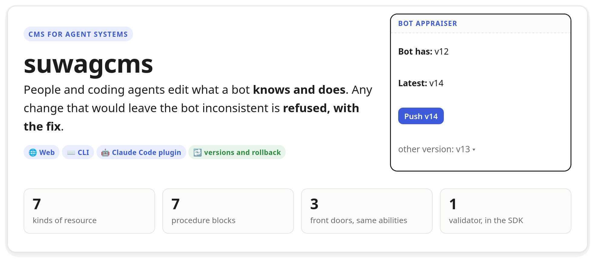
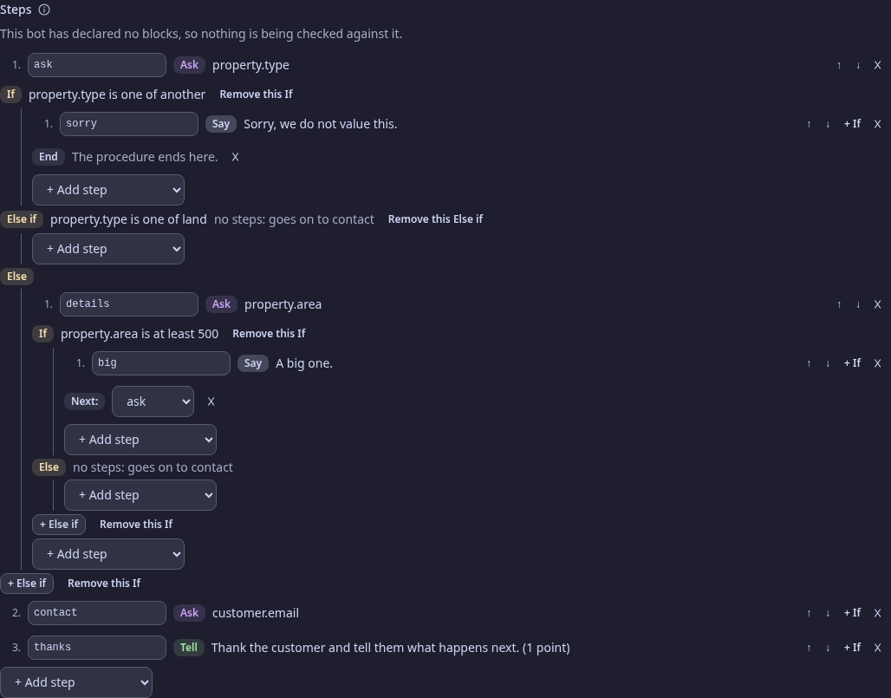
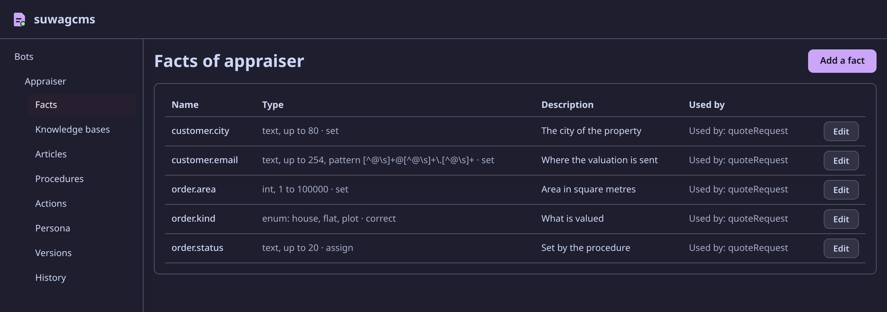
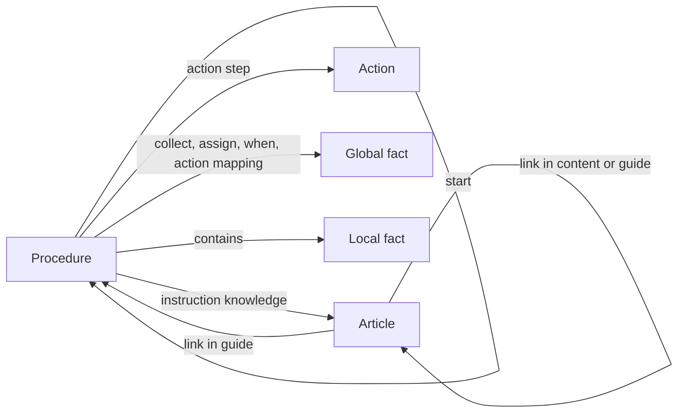
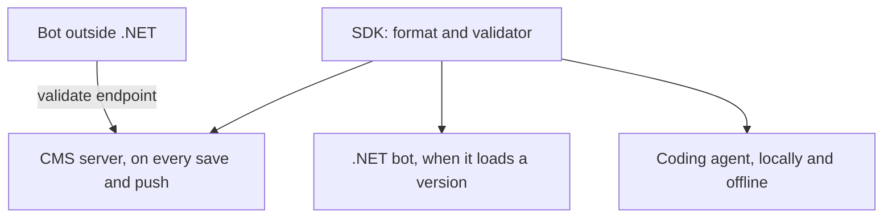

# suwagcms

<picture>
  <source media="(prefers-color-scheme: dark)" srcset="docs/visual/board/img/readme/hero-dark.png">
  
</picture>

> **Status:** built. [`Suwagcms.Sdk`](https://www.nuget.org/packages/Suwagcms.Sdk) is on nuget.org. [Suwchatbot](https://github.com/Manomenu/suwchatbot), the first bot,
> has not moved onto it yet. There is no login: run the CMS and the bots' routes only inside a trusted network.

## Why

<picture>
  <source media="(prefers-color-scheme: dark)" srcset="docs/visual/board/img/readme/why-dark.png">
  
</picture>

## How it works

<picture>
  <source media="(prefers-color-scheme: dark)" srcset="docs/visual/board/img/readme/flow-dark.png">
  
</picture>

The bot does not read the CMS live, so what is saved reaches customers only after a push.

## What it manages

<picture>
  <source media="(prefers-color-scheme: dark)" srcset="docs/visual/board/img/readme/features-dark.png">
  
</picture>





## Three front doors

<picture>
  <source media="(prefers-color-scheme: dark)" srcset="docs/visual/board/img/readme/doors-dark.png">
  
</picture>

## How a bot connects

<picture>
  <source media="(prefers-color-scheme: dark)" srcset="docs/visual/board/img/readme/architecture-dark.png">
  
</picture>

The CMS must be able to reach the bot; the bot never calls the CMS. Routes sit under `/suwagcms`.

## Quick start

Needs .NET SDK 10, Node 24 with pnpm 11, [`just`](https://github.com/casey/just) and Docker: [docs/development.md](docs/development.md).

```sh
just up                  # the whole stack on http://127.0.0.1:8220, then a smoke test
just cli-install         # the suwagcms command, packed from this repository
suwagcms server http://127.0.0.1:8220
suwagcms status
suwagcms bots --help     # register a bot by its address
```

Then, in Claude Code:

```text
/plugin marketplace add Manomenu/suwagcms
/plugin install suwagcms@suwagcms
```

For a bot in .NET, add the package and map its routes:

```sh
dotnet add package Suwagcms.Sdk
```

The package's own readme shows the code: [Suwagcms.Sdk/README.md](Suwagcms.Sdk/README.md).

## The CLI

A coding agent is a first-class editor, not an afterthought. The CMS ships with a CLI and a Claude Code plugin, built
the way [Suwageval](https://github.com/Manomenu/suwalski-agent-eval) builds its own.

**Anything the web can do, the CLI and the plugin can do too.** The CLI may do more than the web, never less.

The CMS is the single source of truth, so nobody edits a local copy. For work that spans many resources the CLI has:

| Command             | What it does                                                                                  |
| :------------------ | :-------------------------------------------------------------------------------------------- |
| `suwagcms apply`    | applies a file of changes all or nothing, so the order of changes inside it does not matter; a dry run only reports what would break; `--replace` applies a seed again over what the CMS holds, and `--compare` says first what that would change |
| `suwagcms export`   | writes a version to files for reading and searching; changes to those files do nothing        |
| `suwagcms diff`     | compares two versions                                                                         |
| `suwagcms persona`  | shows the bot's persona, and replaces the whole of it from a file                             |

| Part              | What it is                                                                                  |
| :---------------- | :------------------------------------------------------------------------------------------ |
| HTTP API          | the one interface of the server; the web and the CLI both use it, and there is no MCP endpoint |
| `suwagcms` CLI    | a .NET tool with a command for every web action, including `suwagcms push` to a bot, `--json` for agents and `--open` to show the matching web page |
| Claude Code plugin| installed from this repository's marketplace; drives the CLI, with a main skill listing every command and a separate skill for work that takes judgment or confirmation |

A web action, its CLI command and its line in the plugin arrive in the same change. The gate fails for a server route
that has no CLI command.

Behaviour shared by all of them:

- Every refusal says what is wrong and how to fix it: `'collect' of step 'ask' names fact 'x', which only an assign step
  may write. Remove it from collect, or give the fact 'writableBy: set'.`
- All mistakes are reported at once, so one pass fixes a whole batch.
- "What uses this?" and "what would this change break?" can be asked without changing anything (dry run).
- An agent may push a version itself; validation, history and rollback are the safeguards.
- Each resource has a full history of what changed and when; once identity arrives it also records who, a person or an
  agent. Until then the CMS and the bots' routes for it run only inside a trusted network.

## Reference

<details>
<summary><b>Bots and profiles</b></summary>

One CMS holds several registered bots, each with its own profile, and the user switches between them. All resources
belong to one bot. References work across that bot's knowledge bases and never between bots.

After registration the CMS asks the bot what it supports:

| Declared              | What the CMS does with it                                       |
| :-------------------- | :-------------------------------------------------------------- |
| format version        | validates and builds versions for that format                   |
| blocks it can run     | offers only those in the editor; refuses any others in a version |
| actions in its code   | shows them as `code` actions, without anyone retyping them       |
| embedding profiles    | refuses a version whose knowledge base names another profile     |

</details>

<details>
<summary><b>Resources, facts, actions and procedures: every field</b></summary>

| Resource       | Fields                                                                                           | Required                                                 |
| :------------- | :----------------------------------------------------------------------------------------------- | :------------------------------------------------------- |
| **Knowledge base** | `id`, `title`, `language`, `embedding`, `results`                                            | all; `language` is `pl` or `en` and defaults to `en`; `embedding` names a profile of the bot; `results` is 1 to 20 |
| **Article**    | `id`, `knowledgeBase`, `title`, `content`, `llmGuide`, `description`                             | all                                                      |
| **Procedure**  | `id`, `description`, `localFacts`, `firstStep`, `steps`, `whenStalled`, `whenInterrupted`         | all except `localFacts` and `whenInterrupted`; `whenStalled` if it collects |
| **Action**     | `id`, `description`, `parameters`, `results`, implementation                                      | all except `parameters` and `results`                    |
| **Global fact**| `name`, `type` and its constraints, `description`, `writableBy`                                  | all; `writableBy` defaults to `set`                      |
| **Local fact** | as a global fact, but it lives inside one procedure                                              | as above                                                 |
| **Persona**    | `personality`, `scope` with `inScope`, `outOfScope`, `whenOutOfScope`; one per bot                | none; an empty text is left out of a version             |

Three fields do different jobs and only `content` is for the customer:

| Article field    | Who reads it                 | What it is for                                               |
| :--------------- | :--------------------------- | :----------------------------------------------------------- |
| `content`        | the customer, through the LLM| what is true                                                 |
| `llmGuide`       | the LLM, with the article    | how to talk about it: tone, what to ask first, what not to say |
| `description`    | the bot's search             | what the article answers, the text it searches by            |

Each field's tooltip in the CMS says what the field is used for.

A knowledge base's `language` is chosen in the web and set through the CLI and the plugin like any other field. An
article takes the language of its knowledge base. The CMS does not link articles as translations.

### Facts

| Type   | Constraints              |
| :----- | :----------------------- |
| `enum` | `values`, at least two   |
| `int`  | `min`, `max`             |
| `text` | `maxLength`, above 0     |

`writableBy` says who may write the fact. Each level includes the ones above it:

| `writableBy`      | Who writes the fact                                         | Can a `collect` step use it? |
| :---------------- | :---------------------------------------------------------- | :--------------------------- |
| `assign`          | only the procedure itself: `assign` steps and action results | no                           |
| `set` (default)   | also the model, once, while the fact is empty               | yes                          |
| `correct`         | also the model, when the customer corrects a known value    | yes                          |

Global facts live for the whole conversation and may have dotted names (`customer.city`). Local facts are gone when
their procedure ends, have no dots in their names, and are invisible to other procedures.

### Actions

An action is a named piece of work a procedure runs without waiting for the customer, such as checking an address in
another system. As in Rasa CALM, a procedure runs it from a step and then branches on facts.

| Rasa action type             | Here                                                                 |
| :--------------------------- | :------------------------------------------------------------------- |
| Response (`utter_…`)         | not an action: the `say` block                                       |
| Custom action                | an **Action** defined in the CMS                                     |
| Default (built-in) action    | the bot's own behaviour, shown read-only                             |

The CMS holds the action's contract. The work happens in one of two places:

| Implementation | Who edits what                                                                                  |
| :------------- | :---------------------------------------------------------------------------------------------- |
| `http`         | the whole action is defined in the CMS: URL, method and references to secrets, never their values |
| `code`         | written in the bot and declared by it; the CMS asks after registration, shows it read-only and controls its availability |

Parameters and results are typed like facts, and the procedure's step maps them to facts. An action therefore never
names a fact itself, so one action can serve many procedures and can also fill local facts. The target fact of a
result is written by the action, so it can be `writableBy: assign`.

`suwagcms actions test <id>` tries a saved action through the bot; anything but a `GET` first asks for `--yes`.
A secret written `{secret:NAME}` is read from the bot's environment variable `SUWAGCMS_SECRET_NAME`.

### Procedures

The editor shows a procedure as a numbered list of steps, and the format stores it as a graph, built on save. Each step holds one block and says where to go next.

| Block     | What it does                                      |
| :-------- | :------------------------------------------------ |
| `listen`  | waits for the next message                        |
| `collect` | asks until the listed facts are known             |
| `say`     | sends a fixed text; `{name}` shows a fact's value |
| `assign`  | overwrites facts with values the author chose     |
| `start`   | starts another procedure                          |
| `inform`  | has the model tell the customer named points      |
| `action`  | runs an action, maps parameters and results       |

The SDK defines this fixed set of blocks: a bot declares which of them it runs, and a bot's custom logic is an action.

`whenInterrupted` says what happens to a procedure when another one is started on top of it: `keep`, the default, or `discard`.
An `inform` holds an `instruction`, optional `knowledge` (entries of `knowledgeBase`, `articles`, `searchQueries`) and `points`, a map from a name to what must be said.

The editor offers the blocks the bot declares and shows the format's rules while the author works: exactly one block per step, rules ending with a default,
no unreachable steps, and `whenStalled` when the procedure collects.
In a `say` text, `{name}` is replaced by the bot with the value of the fact `name`, named as `collect` names it (a local fact by its name
in the procedure), so a customer hears an action's result exactly; braces around anything else are plain text. A placeholder naming a fact
the procedure does not see is refused (`reference.missing`). A placeholder is a use of its fact: it blocks deleting the fact or changing its type,
and renaming the fact rewrites it. In YAML, quote a text that starts with `{`.
An action step goes to `onFailure` when the action fails, and to the optional `onUnavailable` when the action is turned off,
so the customer can be told something other than to try again; without it a turned-off action goes to `onFailure`.

```yaml
checkAddress:
  action: checkServiceability
  with: { address: customer.address }
  results: { serviceable: isServiceable }
  onFailure: tellItFailed
  onUnavailable: tellSomeoneWillCall
  next:
    - when: { isServiceable: { oneOf: [yes] } }
      to: offerPlan
    - to: sayNotServiceable
```

</details>

<details>
<summary><b>How resources reference each other: rules, edit guards, availability</b></summary>



| From → to                   | Blocks deleting the target | Can form a loop | Loop check |
| :-------------------------- | :------------------------- | :-------------- | :--------- |
| Article → article           | yes                        | yes             | refused    |
| Article → procedure         | yes                        | yes             | refused    |
| Procedure → article         | yes                        | yes             | refused    |
| Procedure → procedure       | yes                        | yes             | refused    |
| Procedure → global fact     | yes                        | no              | none needed |
| Procedure → action          | yes                        | no              | none needed |
| Procedure's step → local fact | yes, inside the procedure | no             | none needed |

Facts and actions point at nothing, so they can never be part of a loop. Articles and procedures can point at each
other, so the check covers both together: `evacuation guide → evacuation procedure → evacuation guide` is refused.

### Rules

1. **A referenced resource cannot be deleted.** The refusal lists every referrer, with a link to each.
2. **A reference that closes a loop is refused when it is added**, including a resource pointing at itself. The
   message shows the path: `pricing → discounts → pricing`. So the graph never has a loop, there is always a resource
   nobody references, and everything can be removed in some order.
3. **Loops between steps are fine.** They are how a procedure repeats (`conversation` returns to its own `listen`).
   Rule 2 is about references between resources.
4. **Deleting a procedure deletes its local facts** and removes its outgoing references.
5. **`conversation` cannot be deleted and cannot be the target of `start`:** the format requires it as the base of
   every conversation.
6. **Rules are checked on the server, in one transaction, for every client.** Two people each adding half of a loop at
   the same moment must not both succeed.

### Links inside text

SmartRouter refers to articles by title in free text, so nothing notices when one is renamed. Here, a link to another
article in `content` or `llmGuide`, or to a procedure in `llmGuide`, is inserted from a picker, shown as a chip, and
stored by `id`. Plain text naming a resource is not a reference and is not protected.

### Edits can break referrers too

Protecting deletes is not enough, so an edit is refused when a referrer would stop being valid:

| Edit                                                        | Refused when                                     |
| :---------------------------------------------------------- | :----------------------------------------------- |
| Remove an `enum` value                                      | a `when` or `assign` uses it                     |
| Change a fact's type                                        | any procedure uses the fact                      |
| Narrow an `int` range or `maxLength`                        | an `assign` or a condition falls outside it      |
| Set `writableBy: assign`                                    | a `collect` step names the fact                  |
| Add a global fact with a local fact's name                  | always: inside the procedure the name is ambiguous |
| Name a global fact `<procedureId>.<anything>`               | always: that is how a local fact is named outside |
| Remove or retype an action's parameter or result            | a procedure's step maps it                       |

Renaming an `id` is a single operation that updates every structured link and reference with it.

### Availability is not deletion

Turning a resource off changes whether it can be found, never whether it exists, so it cannot break a reference.

| Off            | Effect                                                                        |
| :------------- | :---------------------------------------------------------------------------- |
| **Article**    | left out of search; a procedure naming it explicitly still gets it            |
| **Procedure**  | the model cannot start it, even from an article's guide; conversations already in it finish |
| **Action**     | a step running it takes `onUnavailable`, or `onFailure` when it has none, which makes it a usable emergency switch |

The screen lists what uses the resource before it is turned off. Facts have no availability.

Availability is a live setting, not part of a version. It takes effect at once, without a push, including for
conversations still on an older version.

</details>

<details>
<summary><b>From editing to the bot: every rule</b></summary>

The bot does not read the CMS live. It runs the version pushed to it, so what is saved in the CMS reaches customers only
after a push.

Each bot's page shows which version it has and offers the push:

```text
Bot has: v12            Latest: v14
                        [ Push v14 ]   other version: [ v13 v ]
```

- **Creating a version and pushing it are separate steps.** "Create version" validates the whole working state and
  freezes it, so unfinished work is not sent by accident, and a version can wait until someone has checked it.
- **Pushing the latest version is the main button.** An older one is chosen in a select, and pushing it is the rollback.
- **The version shown is the one the bot reports**, not the last one the CMS tried to send. A failed push is shown as
  failed, and the bot keeps what it had.
- **A push is validated against what the bot declares now**, so an old version using a block the bot no longer runs is
  refused.
- **A rollback changes only the bot.** The working state and the latest version stay as they are, even if the old
  version holds resources deleted since.
- **The working state is always referentially sound**, but it may be unfinished. A procedure can be incomplete while
  someone builds it. A version cannot.
- **The CMS builds no search index.** Through the SDK, the bot's code takes the articles of the version it loaded. It
  trains its own index from them, or passes them on to an external search system and uses that.
- **A conversation finishes on the version it started on.** The bot keeps an old version until its last conversation
  ends, so a push never changes a procedure under a customer.

</details>

<details>
<summary><b>Validation and the SDK</b></summary>

The CMS owns the definition format and its rules. The rules are one .NET library, published in the SDK, so they cannot
drift apart between the places that use them:



The validator takes a bot's whole definition and what the bot declared, and returns every mistake with its fix. It
needs no database or network. The format of a version is the public contract between the CMS and any bot.

The SDK is a public package on nuget.org, [`Suwagcms.Sdk`](https://www.nuget.org/packages/Suwagcms.Sdk), so any bot can use it; the owner releases it with one command ([docs/release.md](docs/release.md)).

</details>

<details>
<summary><b>Screens</b></summary>

| Screen          | Main job                                                                                 |
| :-------------- | :--------------------------------------------------------------------------------------- |
| Bots            | Register a bot, see what it declared, switch the active profile                          |
| Knowledge bases | Articles with search and filters; editor with content, guide and description side by side |
| Procedures      | List with availability; editor with each mistake beside its step                     |
| Actions         | Contract, implementation, which procedures use it, a test run                            |
| Facts           | Name, type, values, description, `writableBy`, which procedures use it                   |
| Any resource    | "Used by" and "Uses" panels; delete is disabled with the reason when it is referenced    |
| Persona         | One bot's personality and scope, each a plain text with its line breaks                  |
| Versions        | Which version the bot has, what changed in each, create version, validation result, push, rollback |

</details>

<details>
<summary><b>Integration with the bot: who does what</b></summary>

Who owns what between the CMS and a bot, field by field, is settled in one place: the spec `chatbot-contract`.

| The bot                                                     | The CMS                                              |
| :---------------------------------------------------------- | :--------------------------------------------------- |
| loads a pushed version without a restart and reports which it has | pushes versions and shows which one the bot has |
| runs all blocks, including `action`, from the version       | delivers procedures, facts and actions in the version |
| takes articles through the SDK for its own or external search, and reads them by `id` | delivers articles in the version; builds no index |
| lets action results write `assign` facts                    | checks each action's mapping to facts                |
| validates a version with the SDK when it loads it           | validates with the same library before pushing       |
| declares its format version, blocks and code actions        | offers and checks only what the bot declared         |
| keeps old versions until their last conversation ends       | keeps every version for rollback                     |
| applies availability changes at once                        | sends availability changes outside versions          |

</details>

<details>
<summary><b>Decisions</b></summary>

| Question                                                          | Decision                                                                 |
| :---------------------------------------------------------------- | :----------------------------------------------------------------------- |
| What happens to a conversation when a push changes its procedure? | It finishes on the version it started on                                |
| What is the CMS built with?                                       | The `solid-dotnet-app-tpl` template                                      |
| Where does validation live?                                       | In one library in the SDK, used by the CMS, bots and agents              |
| Where is the SDK published?                                       | On nuget.org, as a public package the owner releases with one command |
| Who builds the search index?                                      | The bot, from data the SDK gives it, or an external search system        |
| Does the CMS know who is asking?                                  | Not at first: it stays in a trusted network until `cms-identity`         |
| How are bots and knowledge bases organised?                       | One CMS with several bot profiles; references only within one bot        |
| Do bots declare what they support?                                | Yes: format version, blocks and actions in code                          |
| Can a bot add a block of its own?                                 | No: the SDK defines a fixed set, a bot declares which it runs, and custom logic is an action |
| Can an article reference a procedure?                             | Yes, with a link from the picker in its guide                            |
| What language is an article in?                                   | The language of its knowledge base: `pl` or `en`, `en` by default; no linked translations |
| How do agents work with the CMS?                                  | Through a CLI and a Claude Code plugin with the same abilities as the web |
| What format is article content in?                                | Markdown, with links written as cms:// addresses                         |
| Can a bot run in several instances?                               | Yes, through a version store shared by its instances                     |
| Are the bot's routes protected?                                   | Not at first: trusted network only; a key arrives with `cms-identity`    |
| Who may push a version to a bot?                                  | People and agents                                                        |
| How does a bot get its definition?                                | It runs a pushed version; pushing an older one is the rollback           |
| How is a version made?                                            | With a separate "Create version" step before the push                    |
| Can resources be edited as local files?                           | No: `apply` for batches, `export` and `diff` only for reading            |
| Can a resource in use be turned off?                              | Yes, with the "used by" list shown first                                 |
| When does turning off take effect?                                | At once, without a push                                                  |
| Where do a bot's personality and scope live?                      | In one Persona per bot, in its definition: it reaches the bot with a version |

</details>

<details>
<summary><b>What it borrows from Rasa, ElevenAgents and SmartRouter</b></summary>

| Source         | Taken                                                                                       | Left out, and why                                                                                     |
| :------------- | :------------------------------------------------------------------------------------------ | :---------------------------------------------------------------------------------------------------- |
| **Rasa CALM**  | Required descriptions; deterministic steps; action step then branch on facts; slots an LLM cannot fill (`controlled`, here `assign`); `id` plus `description` as what the model reads | Actions reading and writing any slot directly: explicit mapping lets the CMS check references          |
| **ElevenAgents** | Visual graph of nodes; a tool node with success and failure routes; tool results mapped to variables; secrets kept out of prompts; one document reused in many places | LLM-evaluated transitions: a procedure's rules are deterministic on purpose. Force delete that detaches a document from the agents using it: here a reference always blocks |
| **SmartRouter** | `llmGuide`, an embedded description per article, availability toggle on tools, its TODO's reference checks and "who uses it" view | References by title; procedures disguised as articles                                                  |

Rasa concepts in this project's terms:

| Rasa                               | Suwchatbot                     |
| :--------------------------------- | :----------------------------- |
| flow                               | procedure                      |
| slot                               | fact                           |
| `from_llm` mapping                 | `writableBy: set` or `correct` |
| `controlled` mapping               | `writableBy: assign`           |
| `set_slots`                        | `assign`                       |
| `persisted_slots`                  | a global fact                  |
| reset when the flow ends           | a local fact                   |
| `call`                             | `start`                        |
| flow guard `if`                    | availability (on or off only)  |

</details>

<details>
<summary><b>Sources</b></summary>

- Suwchatbot, branch master: Suwchatbot.Engine/Facts, Suwchatbot.Engine/Loading and the procedure building blocks spec;
  branch feature/global-facts-collection
- SmartRouter: TODO.md, SmartRouter.Core/Connectors/CmsConnector, SmartRouter.Core/Dialogue
- Suwageval: AGENTS.md, docs/front-doors.md and its Claude Code plugin
- Rasa: [flows](https://rasa.com/docs/reference/primitives/flows/), [flow steps](https://rasa.com/docs/reference/primitives/flow-steps/),
  [actions](https://rasa.com/docs/reference/primitives/actions/), [custom actions](https://rasa.com/docs/reference/primitives/custom-actions/),
  [slots](https://rasa.com/docs/reference/primitives/slots)
- ElevenAgents: [workflows](https://elevenlabs.io/docs/agents-platform/customization/agent-workflows),
  [knowledge base](https://elevenlabs.io/docs/eleven-agents/customization/knowledge-base),
  [dynamic variables](https://elevenlabs.io/docs/eleven-agents/customization/personalization/dynamic-variables),
  [deleting a document](https://elevenlabs.io/docs/api-reference/knowledge-base/delete)

</details>

## Development

Stack: built from the [`solid-dotnet-app-tpl`](https://github.com/Manomenu/solid-dotnet-app-tpl) template: .NET 10 with ASP.NET Core minimal APIs and PostgreSQL on the server, React 19 with shadcn/ui and Tailwind on the web, and one gate that decides when a change is done.

Requirements and commands: [docs/development.md](docs/development.md). Rules for contributors and agents: [AGENTS.md](AGENTS.md). Where code goes: [docs/architecture.md](docs/architecture.md).

The pictures here are drawn on [docs/visual/board/readme.html](docs/visual/board/readme.html): edit it, then render it with `vdoc.py render docs/visual/board/readme.html` of the [suwagent plugin](https://github.com/Manomenu/suwalski-agent-plugin). The two screenshots are of the real app.

<details>
<summary><b>The application skeleton</b></summary>

An ASP.NET Core minimal-API server (Npgsql, Dapper, hand-written SQL, grate migrations), a React 19 + shadcn/ui + Tailwind
web app with types generated from the server's OpenAPI document.

</details>

<details>
<summary><b>What the gate guarantees</b></summary>

The gate is [suwgate](https://github.com/Manomenu/suwgate), configured in `suwgate.yml`: `just check` (`suwgate check`) before
calling a change done, the same CI runs; `just check-quick` while working, within a 20-second budget: the repository guards, and
build, csharpier, the .NET guards, eslint, tsc and shellcheck only for what changed since the branch left `master`. It fails on: any
compiler or analyzer warning, banned APIs, a layer used against its order, a folder or project off the lists the guards read, dead
types and packages, vague names, any comment but a tool directive, `dynamic`, a test that leans on the real clock, browser storage,
unpinned images, a stale API contract or generated types, an acceptance criterion without a guardrail, an unresolvable compose file.
The full list, each with its fix: [docs/architecture.md, "What the gate forbids"](docs/architecture.md#what-the-gate-forbids).
Browser tests run separately (`just e2e`), and `just up` starts the container stack and smoke-tests it.

</details>

<details>
<summary><b>The API contract</b></summary>

`contract/openapi.json` is generated from the endpoints and committed: the contract on the boundary, with its version
in `contract/package.json`. `just api-types` regenerates it with the web types (`openapi.d.ts`, whose first line names
the contract's sha256), and the full gate (its `api-version` step, oasdiff) compares it with `master`: a changed contract needs a
higher version, a change that breaks a consumer a higher major. An app in another repository that adapts to a new version of this
contract tags its tests with `contract <name>@<version>` instead of a criterion id; the `contract-pins` step lists them.

</details>

<details>
<summary><b>Spec and guardrails sync</b></summary>

Development is spec-driven, and the gate keeps the code and the specs from drifting apart. A spec in
`docs/visual/spec/` (written with the suwagent `/suwagent:visual-spec` skill) says what to build and
why; its acceptance criteria are the contract:

1. **Every criterion has an id**, `AC-<feature>-<n>`, at the start of its item in the spec's
   acceptance section. `vdoc.py ids` of the suwagent plugin assigns them and never reuses a number;
   an id stays with its criterion for good.
2. **Outside the spec, a criterion lives only as a guardrail** that names its id: a test, a lint rule,
   a build rule. Not as a checklist or a QA note. A criterion that no automated check can prove is
   reworded into plain description or dropped from the spec (the agent asks the owner which).
3. **The full gate checks the link both ways** (`suwgate check`, not `--quick`, so an agent can stop and ask
   about a criterion mid-work):

| The gate fails when | What to do |
| --- | --- |
| a criterion has no guardrail | name its id in a test or rule that fails when the criterion breaks |
| a guardrail names an id no spec defines | restore the criterion, or delete or rename the id |
| an id stands where nothing is checked (production code, a config no tool reads) | move it to the guardrail that proves the criterion |
| a spec has no acceptance section, a criterion without an id or with two, an id defined twice | fix the spec (`vdoc.py ids` numbers new criteria) |

Where each kind of guardrail lives and how it names the id comes with the profiles of `suwgate.yml` (the table is in
suwgate's README): `[Trait("criterion", "AC-notes-1")]` on an xUnit test of any test project (server, SDK, CLI, the gate), the id at
the start of a Vitest or Playwright title (`it("AC-notes-1: a blank note is refused", …)`), `// AC-notes-1` above a rule of
`eslint.config.js` or an option of a tsconfig, `# AC-notes-1` above a rule of `.editorconfig`, the id in the message of a banned-API
line of the app's own, `<!-- AC-notes-1 -->` above a property of `Directory.Build.props`. A kind of its own goes into a criteria.json
at the root, with its row in a table here.

**How it runs.** The `criteria` step runs `vdoc.py criteria` of the
[suwagent plugin](https://github.com/Manomenu/suwalski-agent-plugin), downloaded at the commit and SHA-256 suwgate pins (into
`~/.cache/suwagent/`), the same on a laptop and in CI; without a network the step is a SKIP locally and a failure in CI. Agents
cannot edit the gate, the hooks or the lint configs (a Claude Code hook refuses it); to change them with an agent, start it with
`ALLOW_GATE_EDIT=1 claude`.

What it cannot see: whether a guardrail would really fail when the behaviour breaks.
`/suwagent:visual-guardrails` checks that before a merge.

</details>

## License

[LICENSE](LICENSE)
