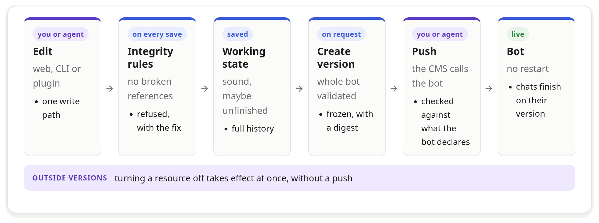
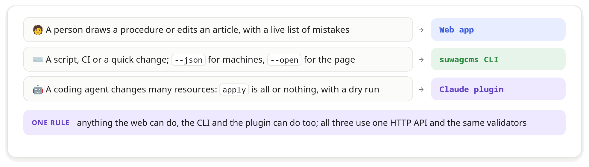
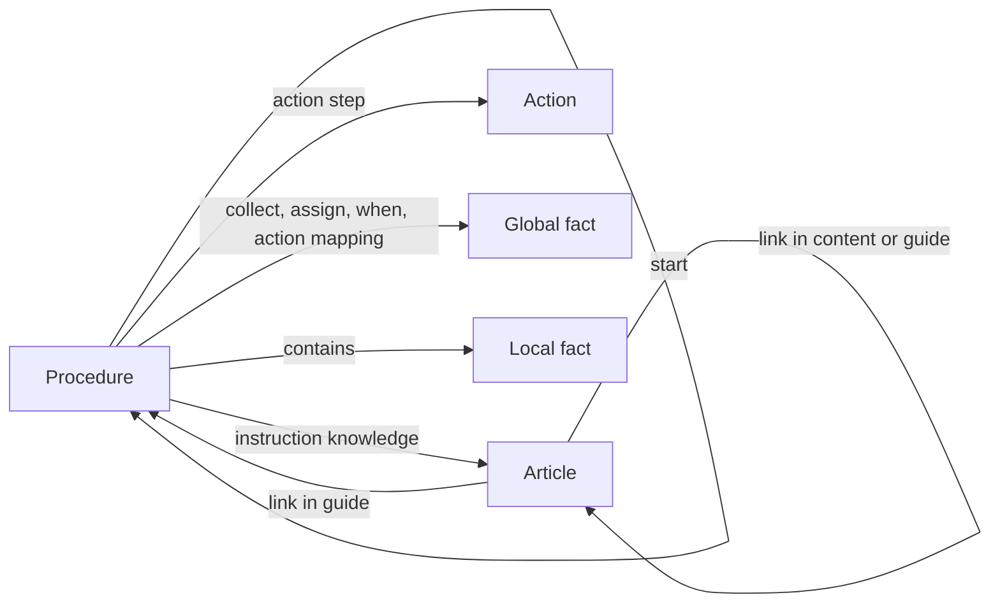
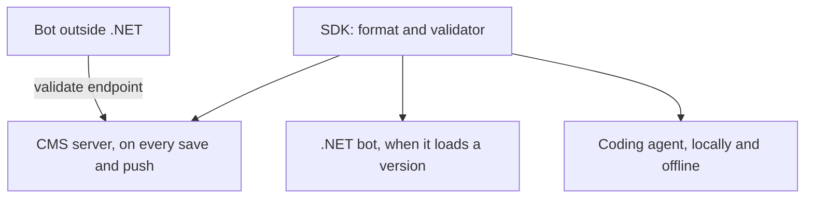

# suwagcms

<picture>
  <source media="(prefers-color-scheme: dark)" srcset="docs/visual/board/img/readme/hero-dark.png">
  
</picture>

Suwagcms holds the definition of an LLM chatbot (its facts, knowledge bases and articles, procedures, actions and persona) and delivers it to
the bot as versions. You edit in the web app, the `suwagcms` CLI or Claude Code; your bot takes versions through the
[`Suwagcms.Sdk`](https://www.nuget.org/packages/Suwagcms.Sdk) package or the same HTTP routes in any language.

> **Status:** built and in use: [Suwchatbot](https://github.com/Manomenu/suwchatbot) runs on `Suwagcms.Sdk` from nuget.org.
> There is no login yet: run the CMS and the bots' routes only inside a trusted network.

## Why

<picture>
  <source media="(prefers-color-scheme: dark)" srcset="docs/visual/board/img/readme/why-dark.png">
  
</picture>

## How it works

<picture>
  <source media="(prefers-color-scheme: dark)" srcset="docs/visual/board/img/readme/flow-dark.png">
  
</picture>

The bot does not read the CMS live, so what is saved reaches customers only after a push.

## What it manages

<picture>
  <source media="(prefers-color-scheme: dark)" srcset="docs/visual/board/img/readme/features-dark.png">
  
</picture>

The procedure editor: a procedure is a numbered list of steps, with `If` / `Else` branches indented under the step they follow.


The facts of a bot, each with its type, who may write it and what uses it:


## Three front doors

<picture>
  <source media="(prefers-color-scheme: dark)" srcset="docs/visual/board/img/readme/doors-dark.png">
  
</picture>

## How a bot connects

<picture>
  <source media="(prefers-color-scheme: dark)" srcset="docs/visual/board/img/readme/architecture-dark.png">
  
</picture>

The CMS must be able to reach the bot; the bot never calls the CMS. Routes sit under `/suwagcms`.

## Quick start

### 1. Run the CMS

Needs Docker. The images build from this repository:

```sh
git clone https://github.com/Manomenu/suwagcms.git && cd suwagcms
docker compose --profile db up -d --build --wait   # web app and API on http://127.0.0.1:8220, with its own PostgreSQL
```

`docker compose --profile db down` stops it; the database volume stays. Ports and an external PostgreSQL are set in `.env`
([Configuration](#configuration)).

### 2. Install the CLI

Needs the .NET 10 SDK. The CLI is the [`Suwagcms.Cli`](https://www.nuget.org/packages/Suwagcms.Cli) .NET tool on nuget.org:

```sh
dotnet tool install --global Suwagcms.Cli
dotnet tool update --global Suwagcms.Cli    # later, for a new version
```

The CLI and the SDK are released together under one version, so pick the same number for both. To run the CLI of your checkout instead,
`just cli-install` (with [`just`](https://github.com/casey/just)) packs it and replaces the installed tool.

### 3. Register a bot and work on it

```sh
suwagcms server http://127.0.0.1:8220      # saved for later commands
suwagcms status                            # is the server reachable?
suwagcms bots add appraiser --name "Property appraiser" --address http://bot-host:5080
suwagcms use appraiser                     # the bot later commands work on
suwagcms bots declaration                  # ask the running bot what it supports
```

`--address` is where the CMS server reaches the bot, so with the CMS in Docker it is not `127.0.0.1`. The CMS never contacts a bot on
`bots add`, so you can register one before it runs. Then edit in the web app, or write a file of
changes and apply it all or nothing:

```yaml
# changes.yaml
changes:
  - add: fact
    name: property.type
    type: enum
    values: [flat, house, land]
    description: What kind of property is valued.
  - add: procedure
    id: conversation          # the base of every conversation: a version needs it
    description: The base of every conversation.
    whenStalled:
      instruction: Ask once more in other words, then offer a phone call.
    firstStep: wait
    steps:
      wait:
        listen:
        next: askType
      askType:
        collect: [property.type]
        next: thanks
      thanks:
        say: "Thanks, a {property.type} it is."
        next: wait
```

```sh
suwagcms apply changes.yaml --dry-run      # every mistake at once, each with its fix; changes nothing
suwagcms apply changes.yaml
suwagcms versions create                   # validate the whole bot and freeze it
suwagcms push                              # send the latest version to the bot
suwagcms versions status                   # the version the bot reports it has
```

### 4. Claude Code

```text
/plugin marketplace add Manomenu/suwagcms
/plugin install suwagcms@suwagcms
```

The plugin drives the CLI: the `suwagcms` skill knows every command and how to read a refusal, and `suwagcms-batch` writes files of
changes for `suwagcms apply`. It needs the CLI from step 2.

### 5. Connect your bot

A bot in .NET (9 or later) adds the SDK and maps its routes:

```sh
dotnet add package Suwagcms.Sdk
```

```csharp
builder.Services.AddSuwagcmsBot("appraiser");   // the bot's id; versions are kept in files under the content root
var app = builder.Build();
app.MapSuwagcmsBot();                           // the /suwagcms routes the CMS calls
```

What the bot declares (blocks it runs, actions in its code), and how its code reads the current version and its articles:
[Suwagcms.Sdk/README.md](Suwagcms.Sdk/README.md).

A bot outside .NET serves the same routes, whose shapes are in [`Suwagcms.Sdk/bot-runtime.schema.json`](Suwagcms.Sdk/bot-runtime.schema.json)
(the definition format: [`definition-format.schema.json`](Suwagcms.Sdk/definition-format.schema.json)), and checks a definition with the
CMS's validator: `suwagcms validate --file definition.yaml [--declaration declaration.yaml]`.

## The CLI

**Anything the web can do, the CLI can do too.** The CMS is the single source of truth, so nobody edits a local copy:
`apply` changes many resources at once, `export` and `diff` are for reading.

| Command | What it does |
| :------ | :----------- |
| `status`, `server <url>` | whether the server answers; save its address |
| `bots`, `use <id>` | list and register bots, ask a bot what it supports (`bots declaration`); choose the bot to work on |
| `facts`, `kb`, `articles`, `procedures`, `actions` | list, show, add, edit and delete each kind; `actions test <id>` tries an action through the bot |
| `persona` | show the bot's persona, and replace the whole of it from a file |
| `usage <kind> <id>` | what uses a resource and what it uses; changes nothing |
| `rename <kind> <id> <newId>` | change an id and rewrite every reference, all or nothing; `--dry-run` lists them |
| `apply <file>` | a file of changes, all or nothing, in any order; `--dry-run`; `--replace` applies a seed again over what the CMS holds, `--compare` says first what that would change |
| `versions` | list, create, show; `versions status` asks the bot which version it has |
| `push` | push the latest version, or `--version <n>`: that is the rollback, and it changes only the bot; `--dry-run` |
| `availability` | turn articles, procedures and actions on and off, at once, outside versions |
| `history [<kind> [<id>]]` | what changed and when, newest first, also after a delete |
| `diff <from> <to>` | what going from one version to another changes |
| `export [<number>] --out <dir>` | a version (the latest when left out) as YAML files, for reading and searching; changes to them do nothing |
| `validate --file <file>` | check a definition with the CMS's validator, for a bot outside .NET; stores nothing |

`suwagcms <command> --help` lists every subcommand and option.

- `--json` prints exactly one JSON document, also on failure, for scripts and agents. `--open` opens the matching page of the web app instead.
- Every refusal says what is wrong and how to fix it, and all mistakes come back at once:
  `'collect' of step 'ask' names fact 'x', which only an assign step may write. Remove it from collect, or give the fact 'writableBy: set'.`
- Exit codes: `0` done, `1` refused, `2` misused, `3` server unreachable, `4` differences found (`apply --compare`).
- An agent may push a version itself; validation, history and rollback are the safeguards.

## Configuration

<details>
<summary><b>The server: <code>.env</code> beside <code>compose.yaml</code></b></summary>

Copy `.env.example` to `.env`. Every line is optional.

| Key | Default | What it sets |
| :-- | :------ | :----------- |
| `WEB_PORT` | `8220` | the port of the web app and API on `127.0.0.1` |
| `POSTGRES_USER`, `POSTGRES_PASSWORD`, `POSTGRES_DB` | `suwagcms` | the bundled PostgreSQL |
| `ConnectionStrings__Default` | the bundled database | an external PostgreSQL; start without the `db` profile: `docker compose up -d --build --wait` |
| `PAGINATION_PAGE_SIZE` | `20` | rows on a page of every list in the web app, 1 to 500; anything else stops the server at start |
| `IMAGE_TAG` | `local` | the tag of the built images |
| `API_UPSTREAM` | `http://server:6330` | where the web container sends `/api` |

</details>

<details>
<summary><b>The CLI: which server and which bot</b></summary>

| Setting | Taken from, first found wins |
| :------ | :--------------------------- |
| server | `--server`, `$SUWAGCMS_URL`, `suwagcmsUrl` in the folder config, the address saved with `suwagcms server`, `http://localhost:3330` |
| bot | `--bot`, `$SUWAGCMS_BOT`, `botId` in the folder config, the bot stored with `suwagcms use` |

The folder config is a file named config.yaml in a folder named suwagcms under the current folder; `--dir <dir>` points at another
folder that holds it. Kept in a bot's repository, it pins that repository to its CMS and bot.

</details>

<details>
<summary><b>The bot: secrets of http actions</b></summary>

An `http` action names a secret as `{secret:NAME}` in a header and never holds its value. The bot reads it from its environment
variable `SUWAGCMS_SECRET_NAME`.

</details>

## Reference

<details>
<summary><b>Bots and profiles</b></summary>

One CMS holds several registered bots, each with its own profile, and the user switches between them. All resources
belong to one bot. References work across that bot's knowledge bases and never between bots.

Once the bot runs, the CMS asks it what it supports (`suwagcms bots declaration`, or the bot's profile page) and keeps a good answer:

| Declared              | What the CMS does with it                                       |
| :-------------------- | :-------------------------------------------------------------- |
| format version        | validates and builds versions for that format                   |
| blocks it can run     | offers only those in the editor; refuses any others in a version |
| actions in its code   | shows them as `code` actions, without anyone retyping them       |
| embedding profiles    | refuses a version whose knowledge base names another profile     |

</details>

<details>
<summary><b>Resources, facts, actions and procedures: every field</b></summary>

| Resource       | Fields                                                                                           | Required                                                 |
| :------------- | :----------------------------------------------------------------------------------------------- | :------------------------------------------------------- |
| **Knowledge base** | `id`, `title`, `language`, `embedding`, `results`                                            | all; `language` is `pl` or `en` and defaults to `en`; `embedding` names a profile of the bot; `results` is 1 to 20 |
| **Article**    | `id`, `knowledgeBase`, `title`, `content`, `llmGuide`, `description`                             | all                                                      |
| **Procedure**  | `id`, `description`, `localFacts`, `firstStep`, `steps`, `whenStalled`, `whenInterrupted`         | all except `localFacts` and `whenInterrupted`; `whenStalled` if it collects |
| **Action**     | `id`, `description`, `parameters`, `results`, implementation                                      | all except `parameters` and `results`                    |
| **Global fact**| `name`, `type` and its constraints, `description`, `writableBy`                                  | all; `writableBy` defaults to `set`                      |
| **Local fact** | as a global fact, but it lives inside one procedure                                              | as above                                                 |
| **Persona**    | `personality`, `scope` with `inScope`, `outOfScope`, `whenOutOfScope`; one per bot                | none; an empty text is left out of a version             |

Three fields do different jobs and only `content` is for the customer:

| Article field    | Who reads it                 | What it is for                                               |
| :--------------- | :--------------------------- | :----------------------------------------------------------- |
| `content`        | the customer, through the LLM| what is true                                                 |
| `llmGuide`       | the LLM, with the article    | how to talk about it: tone, what to ask first, what not to say |
| `description`    | the bot's search             | what the article answers, the text it searches by            |

Each field's tooltip in the CMS says what the field is used for.

A knowledge base's `language` is chosen in the web and set through the CLI and the plugin like any other field. An
article takes the language of its knowledge base. The CMS does not link articles as translations.

### Facts

| Type   | Constraints              |
| :----- | :----------------------- |
| `enum` | `values`, at least two   |
| `int`  | `min`, `max`             |
| `text` | `maxLength`, above 0     |

`writableBy` says who may write the fact. Each level includes the ones above it:

| `writableBy`      | Who writes the fact                                         | Can a `collect` step use it? |
| :---------------- | :---------------------------------------------------------- | :--------------------------- |
| `assign`          | only the procedure itself: `assign` steps and action results | no                           |
| `set` (default)   | also the model, once, while the fact is empty               | yes                          |
| `correct`         | also the model, when the customer corrects a known value    | yes                          |

Global facts live for the whole conversation and may have dotted names (`customer.city`). Local facts are gone when
their procedure ends, have no dots in their names, and are invisible to other procedures.

### Actions

An action is a named piece of work a procedure runs without waiting for the customer, such as checking an address in
another system. As in Rasa CALM, a procedure runs it from a step and then branches on facts.

| Rasa action type             | Here                                                                 |
| :--------------------------- | :------------------------------------------------------------------- |
| Response (`utter_…`)         | not an action: the `say` block                                       |
| Custom action                | an **Action** defined in the CMS                                     |
| Default (built-in) action    | the bot's own behaviour, shown read-only                             |

The CMS holds the action's contract. The work happens in one of two places:

| Implementation | Who edits what                                                                                  |
| :------------- | :---------------------------------------------------------------------------------------------- |
| `http`         | the whole action is defined in the CMS: URL, method and references to secrets, never their values |
| `code`         | written in the bot and declared by it; the CMS asks after registration, shows it read-only and controls its availability |

Parameters and results are typed like facts, and the procedure's step maps them to facts. An action therefore never
names a fact itself, so one action can serve many procedures and can also fill local facts. The target fact of a
result is written by the action, so it can be `writableBy: assign`.

`suwagcms actions test <id>` tries a saved action through the bot; anything but a `GET` first asks for `--yes`.
A secret written `{secret:NAME}` is read from the bot's environment variable `SUWAGCMS_SECRET_NAME`.

### Procedures

The editor shows a procedure as a numbered list of steps, and the format stores it as a graph, built on save. Each step holds one block and says where to go next.

| Block     | What it does                                      |
| :-------- | :------------------------------------------------ |
| `listen`  | waits for the next message                        |
| `collect` | asks until the listed facts are known             |
| `say`     | sends a fixed text; `{name}` shows a fact's value |
| `assign`  | overwrites facts with values the author chose     |
| `start`   | starts another procedure                          |
| `inform`  | has the model tell the customer named points      |
| `action`  | runs an action, maps parameters and results       |

The SDK defines this fixed set of blocks: a bot declares which of them it runs, and a bot's custom logic is an action.

`whenInterrupted` says what happens to a procedure when another one is started on top of it: `keep`, the default, or `discard`.
An `inform` holds an `instruction`, optional `knowledge` (entries of `knowledgeBase`, `articles`, `searchQueries`) and `points`, a map from a name to what must be said.

The editor offers the blocks the bot declares and shows the format's rules while the author works: exactly one block per step, rules ending with a default,
no unreachable steps, and `whenStalled` when the procedure collects.
In a `say` text, `{name}` is replaced by the bot with the value of the fact `name`, named as `collect` names it (a local fact by its name
in the procedure), so a customer hears an action's result exactly; braces around anything else are plain text. A placeholder naming a fact
the procedure does not see is refused (`reference.missing`). A placeholder is a use of its fact: it blocks deleting the fact or changing its type,
and renaming the fact rewrites it. In YAML, quote a text that starts with `{`.
An action step goes to `onFailure` when the action fails, and to the optional `onUnavailable` when the action is turned off,
so the customer can be told something other than to try again; without it a turned-off action goes to `onFailure`.

```yaml
checkAddress:
  action: checkServiceability
  with: { address: customer.address }
  results: { serviceable: isServiceable }
  onFailure: tellItFailed
  onUnavailable: tellSomeoneWillCall
  next:
    - when: { isServiceable: { oneOf: [yes] } }
      to: offerPlan
    - to: sayNotServiceable
```

</details>

<details>
<summary><b>How resources reference each other: rules, edit guards, availability</b></summary>



| From → to                   | Blocks deleting the target | Can form a loop | Loop check |
| :-------------------------- | :------------------------- | :-------------- | :--------- |
| Article → article           | yes                        | yes             | refused    |
| Article → procedure         | yes                        | yes             | refused    |
| Procedure → article         | yes                        | yes             | refused    |
| Procedure → procedure       | yes                        | yes             | refused    |
| Procedure → global fact     | yes                        | no              | none needed |
| Procedure → action          | yes                        | no              | none needed |
| Procedure's step → local fact | yes, inside the procedure | no             | none needed |

Facts and actions point at nothing, so they can never be part of a loop. Articles and procedures can point at each
other, so the check covers both together: `evacuation guide → evacuation procedure → evacuation guide` is refused.

### Rules

1. **A referenced resource cannot be deleted.** The refusal lists every referrer, with a link to each.
2. **A reference that closes a loop is refused when it is added**, including a resource pointing at itself. The
   message shows the path: `pricing → discounts → pricing`. So the graph never has a loop, there is always a resource
   nobody references, and everything can be removed in some order.
3. **Loops between steps are fine.** They are how a procedure repeats (`conversation` returns to its own `listen`).
   Rule 2 is about references between resources.
4. **Deleting a procedure deletes its local facts** and removes its outgoing references.
5. **`conversation` cannot be deleted and cannot be the target of `start`:** the format requires it as the base of
   every conversation.
6. **Rules are checked on the server, in one transaction, for every client.** Two people each adding half of a loop at
   the same moment must not both succeed.

### Links inside text

Free text that names an article by its title breaks silently when the article is renamed. Here, a link to another
article in `content` or `llmGuide`, or to a procedure in `llmGuide`, is inserted from a picker, shown as a chip, and
stored by `id`. Plain text naming a resource is not a reference and is not protected.

### Edits can break referrers too

Protecting deletes is not enough, so an edit is refused when a referrer would stop being valid:

| Edit                                                        | Refused when                                     |
| :---------------------------------------------------------- | :----------------------------------------------- |
| Remove an `enum` value                                      | a `when` or `assign` uses it                     |
| Change a fact's type                                        | any procedure uses the fact                      |
| Narrow an `int` range or `maxLength`                        | an `assign` or a condition falls outside it      |
| Set `writableBy: assign`                                    | a `collect` step names the fact                  |
| Add a global fact with a local fact's name                  | always: inside the procedure the name is ambiguous |
| Name a global fact `<procedureId>.<anything>`               | always: that is how a local fact is named outside |
| Remove or retype an action's parameter or result            | a procedure's step maps it                       |

Renaming an `id` is a single operation that updates every structured link and reference with it.

### Availability is not deletion

Turning a resource off changes whether it can be found, never whether it exists, so it cannot break a reference.

| Off            | Effect                                                                        |
| :------------- | :---------------------------------------------------------------------------- |
| **Article**    | left out of search; a procedure naming it explicitly still gets it            |
| **Procedure**  | the model cannot start it, even from an article's guide; conversations already in it finish |
| **Action**     | a step running it takes `onUnavailable`, or `onFailure` when it has none, which makes it a usable emergency switch |

The screen lists what uses the resource before it is turned off. Facts have no availability.

Availability is a live setting, not part of a version. It takes effect at once, without a push, including for
conversations still on an older version.

</details>

<details>
<summary><b>From editing to the bot: every rule</b></summary>

The bot does not read the CMS live. It runs the version pushed to it, so what is saved in the CMS reaches customers only
after a push.

Each bot's page shows which version it has and offers the push:

```text
Bot has: v12            Latest: v14
                        [ Push v14 ]   other version: [ v13 v ]
```

- **Creating a version and pushing it are separate steps.** "Create version" validates the whole working state and
  freezes it, so unfinished work is not sent by accident, and a version can wait until someone has checked it.
- **Pushing the latest version is the main button.** An older one is chosen in a select, and pushing it is the rollback.
- **The version shown is the one the bot reports**, not the last one the CMS tried to send. A failed push is shown as
  failed, and the bot keeps what it had.
- **A push is validated against what the bot declares now**, so an old version using a block the bot no longer runs is
  refused.
- **A rollback changes only the bot.** The working state and the latest version stay as they are, even if the old
  version holds resources deleted since.
- **The working state is always referentially sound**, but it may be unfinished. A procedure can be incomplete while
  someone builds it. A version cannot.
- **The CMS builds no search index.** Through the SDK, the bot's code takes the articles of the version it loaded. It
  trains its own index from them, or passes them on to an external search system and uses that.
- **Each resource has a full history** of what changed and when, also after it is deleted (`suwagcms history`, the History panel of
  every screen). Who changed it arrives with login.
- **A conversation finishes on the version it started on.** The bot keeps an old version until its last conversation
  ends, so a push never changes a procedure under a customer.

</details>

<details>
<summary><b>Validation and the SDK</b></summary>

The CMS owns the definition format and its rules. The rules are one .NET library, published in the SDK, so they cannot
drift apart between the places that use them:



The validator takes a bot's whole definition and what the bot declared, and returns every mistake with its fix. It
needs no database or network. The format of a version is the public contract between the CMS and any bot.

The SDK is a public package on nuget.org, [`Suwagcms.Sdk`](https://www.nuget.org/packages/Suwagcms.Sdk), so any bot can use it.

</details>

<details>
<summary><b>Screens</b></summary>

| Screen          | Main job                                                                                 |
| :-------------- | :--------------------------------------------------------------------------------------- |
| Bots            | Register a bot, see what it declared, switch the active profile                          |
| Knowledge bases | Articles with search and filters; editor with content, guide and description side by side |
| Procedures      | List with availability; editor with each mistake beside its step                     |
| Actions         | Contract, implementation, which procedures use it, a test run                            |
| Facts           | Name, type, values, description, `writableBy`, which procedures use it                   |
| Any resource    | "Used by" and "Uses" panels; delete is disabled with the reason when it is referenced    |
| Persona         | One bot's personality and scope, each a plain text with its line breaks                  |
| Versions        | Which version the bot has, what changed in each, create version, validation result, push, rollback |

</details>

<details>
<summary><b>Integration with the bot: who does what</b></summary>

| The bot                                                     | The CMS                                              |
| :---------------------------------------------------------- | :--------------------------------------------------- |
| loads a pushed version without a restart and reports which it has | pushes versions and shows which one the bot has |
| runs all blocks, including `action`, from the version       | delivers procedures, facts and actions in the version |
| takes articles through the SDK for its own or external search, and reads them by `id` | delivers articles in the version; builds no index |
| lets action results write `assign` facts                    | checks each action's mapping to facts                |
| validates a version with the SDK when it loads it           | validates with the same library before pushing       |
| declares its format version, blocks and code actions        | offers and checks only what the bot declared         |
| keeps old versions until their last conversation ends       | keeps every version for rollback                     |
| applies availability changes at once                        | sends availability changes outside versions          |

</details>

<details>
<summary><b>The HTTP API</b></summary>

The web app, the CLI and the plugin all use one HTTP API under `/api`; there is no MCP endpoint. Its contract is
[`contract/openapi.json`](contract/openapi.json), with its version in [`contract/package.json`](contract/package.json): a change that
breaks a consumer raises the major version.

</details>

<details>
<summary><b>Coming from Rasa</b></summary>

Rasa concepts in this project's terms:

| Rasa                               | Suwagcms                       |
| :--------------------------------- | :----------------------------- |
| flow                               | procedure                      |
| slot                               | fact                           |
| `from_llm` mapping                 | `writableBy: set` or `correct` |
| `controlled` mapping               | `writableBy: assign`           |
| `set_slots`                        | `assign`                       |
| `persisted_slots`                  | a global fact                  |
| reset when the flow ends           | a local fact                   |
| `call`                             | `start`                        |
| flow guard `if`                    | availability (on or off only)  |

</details>

## Development

Built from the [`solid-dotnet-app-tpl`](https://github.com/Manomenu/solid-dotnet-app-tpl) template: .NET 10 with ASP.NET Core minimal
APIs and PostgreSQL on the server, React 19 on suwfrontkit with Tailwind on the web, and one gate,
[suwgate](https://github.com/Manomenu/suwgate) (`just check`), that decides when a change is done.

Requirements and commands: [docs/development.md](docs/development.md). Rules for contributors and agents: [AGENTS.md](AGENTS.md).
Where code goes and what the gate forbids: [docs/architecture.md](docs/architecture.md). Releasing the SDK: [docs/release.md](docs/release.md).

The pictures here are drawn on [docs/visual/board/readme.html](docs/visual/board/readme.html): edit it, then render it with
`vdoc.py render docs/visual/board/readme.html` of the [suwagent plugin](https://github.com/Manomenu/suwalski-agent-plugin). The two
screenshots are of the real app.

## License

[MIT](LICENSE)
